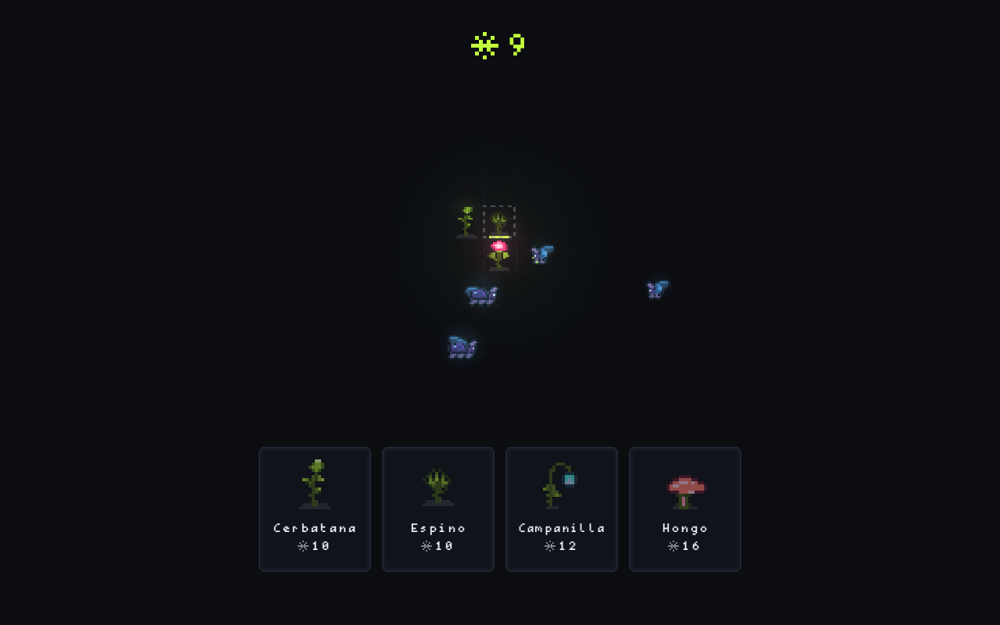

# Herbarium

Un jardín chico que crece en la oscuridad. Una planta en el centro genera energía y luz. Con esa energía podés extender el jardín con Cerbatanas, Espinos, Campanillas y Hongos. Escarabajos, pulgones y orugas intentan llegar al centro. Si la planta central muere, el jardín cae.

El proyecto es independiente. Más adelante va a vivir dentro de la web personal del autor. Ahora es una partida continua: tablero, cuatro plantas comprables, tres insectos y oleadas procedurales. No hay tarot, sonido ni progresión entre partidas.



## Estado

Etapa 08.3 integrada. El Espino desvía insectos cercanos, la Campanilla prolonga su exposición al fuego y el Hongo limpia grupos. El escarabajo amortigua disparos en vuelo, el pulgón sobrevuela plantas comunes y la oruga intensifica sus mordidas cuando se afianza. Los puntos del borde anuncian la primera entrada de cada oleada.

Elegí o tocá una carta para leer su función, incluso si todavía te falta energía. Para plantar, elegí una casilla libre junto al jardín. En pantalla táctil, el primer toque en una casilla previsualiza y el segundo confirma.

También podés arrastrar la carta y soltarla en una casilla válida. Acercá el jardín con la rueda o con dos dedos. Cuando esté ampliado, arrastrá el tablero para moverte. Con el tablero enfocado, usá `+` y `−` para el zoom y `0` para volver a la vista completa.

La pala permite retirar plantas por la mitad del coste que pagaste. En táctil, el primer toque muestra el reembolso y el segundo confirma. Al superar una invasión, el jardín se detiene brevemente para revelar el resultado antes de la preparación siguiente.

El [informe de la etapa 08.3](docs/ETAPA_083.md) reúne estadísticas, escenarios y evidencia de la calibración. Los valores jugables viven en `src/config.js`.

## Tecnología

HTML, CSS y módulos ES. Canvas 2D. Sin dependencias y sin bundler. Node 24 solo para el servidor estático de desarrollo y para `node --test`.

## Requisitos

- Node.js 24
- Un navegador con módulos ES y Canvas 2D

## Jugar

Demo en GitHub Pages: <https://hatemecha.github.io/herbarium/>

## Uso

```
npm start
```

Abre <http://localhost:4173/>. Otro puerto: `PORT=4180 npm start` (en PowerShell, `$env:PORT=4180; npm start`).

```
npm test
```

Corre las pruebas de colocación, combate, escenarios e insecto. No abren el navegador.

## Documentación

- [AGENTS.md](AGENTS.md) — reglas para quien modifique el proyecto
- [docs/GAME_DESIGN.md](docs/GAME_DESIGN.md)
- [docs/ART_DIRECTION.md](docs/ART_DIRECTION.md)
- [docs/ARCHITECTURE.md](docs/ARCHITECTURE.md)
- [docs/BALANCE.md](docs/BALANCE.md)
- [docs/ROADMAP.md](docs/ROADMAP.md)
- [docs/PROPUESTA_OLEADAS.md](docs/PROPUESTA_OLEADAS.md)

## Créditos

MonoMEK Text, de Michael Alexander (MEK.txt), 2023. Dominio público, [CC0 1.0](https://creativecommons.org/publicdomain/zero/1.0/). Archivos en `assets/fonts/`. El texto legal está en `assets/fonts/MonoMEK-LICENSE.txt`.

La paleta de color sigue la de la web personal (`nicotinalex-web`).

## Licencia del juego

No definida. Publicar este repositorio no lo pone bajo una licencia open source. Los archivos de MonoMEK conservan su CC0.
