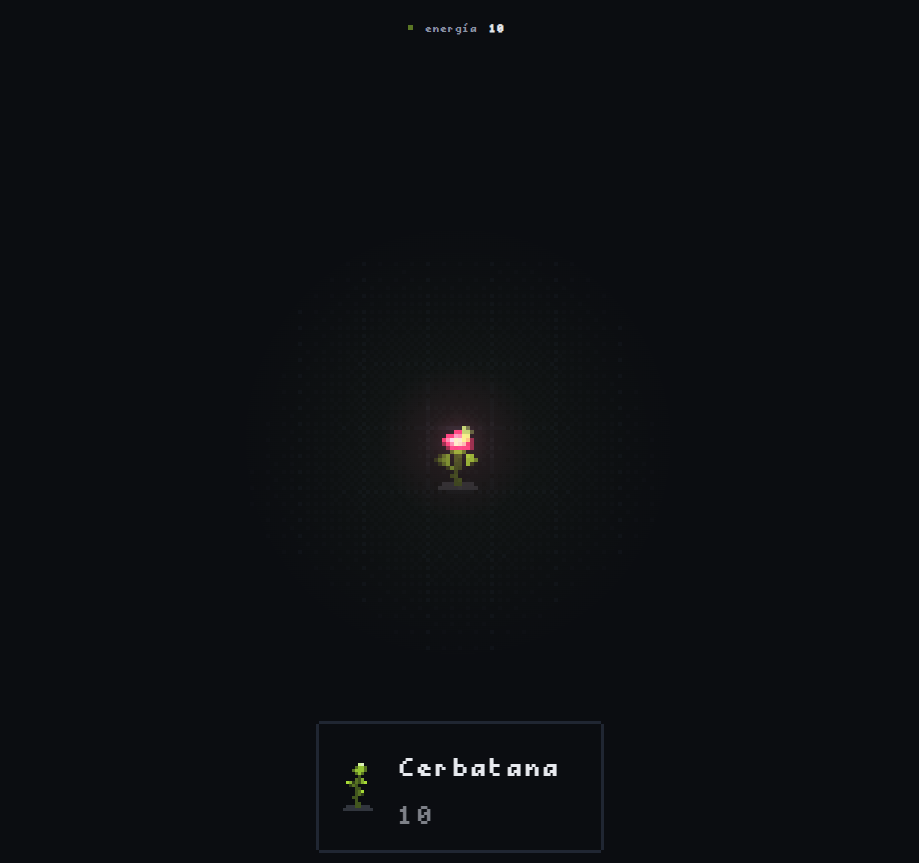

# Dirección de arte

La pieza de referencia es el juego que ya corre, no un pixel art genérico. Identidad heredada de `nicotinalex-web`: monocromo oscuro, línea de 1 px, plano, acentos solo en la marca (`brand`) y la chispa (`spark`).

Captura del estado inicial real (`npm start`, Chromium, energía en 10, cerbatana ya comprable):



No incluye combate. El escarabajo todavía no había aparecido.

Capturas del combate real (partida reproducible con reloj falso y semilla fija, dpr 3):

| Momento | Archivo |
| --- | --- |
| Escarabajo en vuelo bajo, a 22,5 s | [escarabajo-vuelo.png](capturas/escarabajo-vuelo.png) |
| Impacto del proyectil de la cerbatana, a 24,5 s | [escarabajo-combate.png](capturas/escarabajo-combate.png) |
| Alimentación sobre la central, sin defensa, a 40 s | [escarabajo-alimentacion.png](capturas/escarabajo-alimentacion.png) |
| Derrota: la central marchita, aviso y reinicio | [derrota.png](capturas/derrota.png) |
| Cuadros del escarabajo a 6× junto a la central y la cerbatana | [escarabajo-cuadros.png](capturas/escarabajo-cuadros.png) |
| Galería de la etapa 06, escala 1 y 4 | [galeria.png](capturas/galeria.png), [galeria-insectos.png](capturas/galeria-insectos.png) |

## Escena

Un organismo chico en mucha oscuridad. El tablero lógico mide 11×11 casillas de 16 px: 176×176. El sprite cabe en una casilla. Esos dos 16 están separados a propósito (`TABLERO.celda` y `SPRITE.lado` en `src/config.js`) y hoy coinciden.

La cámara no se mueve. La grilla lógica (casillas) y la grilla de píxeles (el canvas de 176) son distintas. El enemigo y el proyectil se mueven en continuo y se dibujan con `Math.round`, sin quedar trabados a la casilla.

## Escalado

`src/escala.js`. Se elige un entero de ampliación cuando el tablero ocupa al menos el 80 % del lado disponible en píxeles físicos (`ESCALA.aprovechamientoMinimo`). Si no, se usa el lado físico disponible. `devicePixelRatio` entra en ese cálculo. El canvas de salida desactiva el suavizado al copiar la escena, la oscuridad y la capa luminosa. El CSS del tablero y de las tarjetas usa `image-rendering: pixelated`.

El resplandor radial se dibuja después, con suavizado activado, en la resolución de salida. Es glow, no el sprite. No rotar ni escalar un sprite con interpolación para “apuntar”: la cerbatana tiene ocho dibujos y el escarabajo se espeja.

## Paleta

`src/paleta.js` repite las claves y los hex de `nicotinalex-web/src/styles/paleta.ts`:

| Clave | Hex |
| --- | --- |
| bg | `#0b0d11` |
| panel | `#10141b` |
| hover | `#141820` |
| line | `#2a3140` |
| muted | `#8b93a3` |
| ink | `#e8eaef` |
| active-bg | `#d5dae3` |
| active-ink | `#10131a` |
| brand | `#ff3b7a` |
| spark | `#c2ff3d` |

Si el documento ya define `--bg`, `--brand`, etc., el juego los lee. Si no, los escribe. No hay `hue-rotate`. Los roles salen de mezclas entre esos colores (`mezcla` en `crearRoles`).

Roles en uso: `fondo`, `terreno`, `cuadricula`, `tierra`, `hojaSombra`, `hoja`, `hojaLuz`, `hojaBrillo`, `tallo`, `petaloSombra`, `petalo`, `nucleo`, `nucleoBrillo`, `particula`, `resplandor`, `ambiental`, `marca`, `marcaSuave`, `bulboSombra`, `bulbo`, `boca`, `bocaBrillo`, y los de insecto de la sección siguiente.

### Familia de insectos

Los insectos tienen roles propios, no mezclas de la marca ni del fondo. Se derivan en `rolesInsecto` (`src/paleta.js`) a partir de los colores activos, sin hex nuevos:

- El **matiz base** es el centro del mayor hueco de matiz entre la marca y la chispa. Con la paleta base cae en un azul-verdoso (≈ 210°). Ese punto está a más de 90° de ambos colores activos, así que el insecto no se confunde con las plantas.
- El **caparazón** va 50° hacia el violeta (≈ 260°). El azul del brillo y de las alas queda en el matiz base.
- El **reflejo cálido** es la marca mezclada con la tinta al 35 %. Aparece en uno o dos píxeles, nunca como contorno.
- Con otra marca, la familia se recoloca. Probado con marca azul y chispa ámbar: el insecto pasa a verde azulado, sigue separado de ambos colores y mantiene el contraste.

| Rol | Uso | Luminosidad relativa |
| --- | --- | --- |
| `insectoSombra` | contorno y vientre | la más oscura, apenas sobre el fondo |
| `insecto` | caparazón | medios tonos |
| `insectoLuz` | dorso iluminado | la más clara del caparazón |
| `insectoBrillo` | reflejo irisado azul | más clara que el caparazón |
| `insectoImpacto` | destello de daño | tinta con un tinte del brillo del insecto |
| `insectoReflejo` | punto cálido | marca + tinta |
| `cabeza` | cabeza, algo más oscura que el caparazón | |
| `ojo` | un píxel de brillo | la más clara del insecto |
| `antena`, `patas` | apéndices | medios tonos claros |
| `ala`, `alaBorde` | membrana y nervio | `ala` oscura, `alaBorde` ~ medio |

El test `tests/insecto.test.mjs` fija el orden de luminosidad y la distancia de matiz con la chispa y la marca.

Un sprite nuevo mapea caracteres a estos roles, o añade un rol en `crearRoles` a partir de la misma base. No hardcodear un hex en el render.

## Tipografía

MonoMEK Text 1.204, © 2023 Michael Alexander (MEK.txt), dedicada al dominio público con CC0 1.0. Archivos: `assets/fonts/MonoMEK-Text.otf` y `assets/fonts/MonoMEK-LICENSE.txt`. Enlace del autor en los metadatos de la fuente: <https://linktr.ee/michaelmicasso>.

`styles.css` declara `@font-face` con `font-display: block`. El cuerpo de la interfaz usa 12 px, que en MonoMEK cae en su cuadrícula (el em interno es 15). La pila es `"MonoMEK", ui-monospace, "DejaVu Sans Mono", monospace`, inyectada como `--mono` solo si el documento todavía no tiene esa variable. En la web de referencia `--mono` existe y no nombra a MonoMEK: al embeber el juego hay que decidir cuál gana.

## Sprites

Dibujados a mano como matrices de 16 caracteres. `.` es transparente. `src/sprites/dibujo.js` los convierte en canvas de 16×16 ya coloreados: `frames[id][direccion][variante]`. Una variante es una lista de parches sobre la matriz base; el escarabajo calcula sus parches comparando cada cuadro completo con el reposo.

| Pieza | Archivo | Direcciones | Notas |
| --- | --- | --- | --- |
| Planta central | `src/sprites/planta.js` | 1 | Pétalos, núcleo, hojas, tallo, tierra. Idle irregular. |
| Cerbatana | `src/sprites/cerbatana.js` | 8 | Bulbo y boca dibujados para N, NE, E, SE y S; el resto es espejo. No es una copia de otra torre. |
| Escarabajo | `src/sprites/escarabajo.js` | 1 de perfil, espejo izquierda/derecha | Sin rediseño en la etapa 06. Su calidad sigue sin aprobación del propietario. |
| Pulgón alado | `src/sprites/pulgon.js` | 1 de perfil, espejo | Abdomen azul, patas finas y alas cortas ancladas al tórax en sus dos cuadros de vuelo. |
| Oruga | `src/sprites/oruga.js` | 1 de perfil, espejo | Segmentos violáceos con luces escalonadas. Se estira y se contrae sobre el suelo. |
| Campanilla | `src/sprites/campanilla.js` | 1 | Tallo arqueado, flor colgante fría y pulso breve. |
| Hongo | `src/sprites/hongo.js` | 1 | Sombrero ancho, franja en la superficie y destello breve al esporar. |
| Espino | `src/sprites/espino.js` | 1 | Mata baja con púas. Luz más tenue que la cerbatana, definida en el catálogo. |

La comparación a escala 1 y 4 está en `galeria.html`. No se enlaza desde la partida.

La variante de disparo de la cerbatana es el índice 3 (`VARIANTE_DISPARO` en `src/entidades/planta.js`): la usa el disparo, no el ciclo idle. El retroceso es un desplazamiento de como mucho 1 px, redondeado, en contra del tiro (`BALANCE.visual.retroceso` = 0,12 s).

Para un sprite nuevo: misma matriz, mismos roles, variantes por parches de pocos píxeles, secuencia con duraciones en segundos en el módulo del sprite, registro en `src/catalogo.js`. Estudiar los tres que ya existen antes de inventar otro trazo.

## Animación

`src/animacion.js`. Cada tipo trae `SECUENCIA`: `{ fotograma, duracion }` en segundos. El desfase inicial evita que todas respiren juntas. Con `prefers-reduced-motion: reduce` el índice vuelve al fotograma 0 y no avanza.

La central no usa un compás regular (duraciones entre 0,6 y 1,8 s).

El escarabajo no usa `crearAnimacion`: su cuadro sale de su estado visual (`fotogramaEnemigo` en `src/entidades/enemigo.js`):

- **Vuelo:** ciclo corto de alas alta, media, baja, media (0,05 s cada cuadro). Con movimiento reducido, alas a media altura fijas.
- **Despegue:** alas altas mientras sube tras perder su planta (`BALANCE.visual.despegue`, 0,25 s).
- **Aterrizaje:** alas bajas, luego patas abiertas durante `BALANCE.visual.aterrizaje` (0,3 s). La altura baja hasta el suelo.
- **Alimentación:** reposo con las alas plegadas. En cada mordida la cabeza baja un píxel (`BALANCE.visual.mordisco`, 0,2 s). Cada 1,6 s las antenas caen 0,25 s.
- **Caída:** reposo mientras se desintegra.

Los tiempos visuales no cambian cuándo muerde ni cuándo dispara. La mordida la cuenta la simulación; el cuadro solo la muestra.

## Vuelo e insectos

El escarabajo vuela a 3 píxeles lógicos sobre el suelo (`INSECTO.altura`). Una oscilación decorativa de ±1 px, con período de 0,9 s (`INSECTO.balanceo`), sube y baja el sprite; sin movimiento reducido no oscila. La sombra queda en el suelo: un parche de 6×1 y 4×1 px en el color `fondo`, con alfa creciente con la altura (`INSECTO.sombra`). Esa diferencia entre sprite y sombra es lo que deja leer la altura.

La oscilación, el aleteo y la elevación afectan solo al dibujo. La posición lógica, las colisiones, el alcance y la trayectoria de los proyectiles siguen en `x, y`.

Se mira hacia la planta al fijar objetivo. Mientras vuela se orienta según el avance horizontal. Los espejos son horizontales; no hay rotaciones interpoladas.

## Lenguaje para los próximos insectos

Principios que sigue el escarabajo y que los siguientes deben respetar. Sin estos cinco puntos, un insecto nuevo rompe el ecosistema:

1. **Organismo, no monstruo.** Anatomía reconocible (cabeza, patas, antenas, alas o caparazón) a 16 px. Sin ojos rojos ni emblemas genéricos.
2. **Proporción con las plantas.** El cuerpo mide entre 8 y 11 px de ancho. Un insecto no compite en tamaño con la central.
3. **Perspectiva única.** Todo perfil de tres cuartos o de lado, mirando a la derecha y con espejo. No mezclar cenital con lateral dentro de la misma familia.
4. **Color de familia.** Roles propios derivados de la paleta activa. Se separa de la chispa y de la marca por matiz, no por brillo.
5. **Estado visible.** Cada comportamiento (vuelo, aterrizaje, alimentación, caída) tiene su cuadro o su gesto. Si el jugador no distingue lo que hace el insecto, falta un cuadro.

Diferencias funcionales entre especies: velocidad, altura de vuelo, tamaño del cuerpo y forma de atacar deben notarse en la silueta antes que en el color.

## Oscuridad, luz y partículas

La oscuridad es composición. `src/iluminacion.js` guarda una transmisión por píxel lógico. La central se recalcula cada frame (núcleo, brillo, ambiente, seno de 5θ, pulso, impulso). Cada planta con `luz` aporta un mapa estático que se combina con `t *= 1 - factor * (1 - valor)`. `factor` sigue la opacidad, así la luz se apaga con la marchitez. Seis niveles de Bayer 4×4 (`LUZ.niveles`). Sin shaders ni raycasting.

Encima, `src/render.js` vuelve a dibujar las plantas en una capa luminosa multiplicadas por `propia` (central 0,55, cerbatana 0,5). Su destello de daño usa esa misma capa en modo `lighter`. El glow (central, cerbatana, escarabajo y casilla marcada) va al final, en la resolución de pantalla.

El escarabajo usa una capa luminosa con alfa 0,8, un filete tenue de un píxel lógico y un resplandor corto del color de su reflejo. Al recibir daño se refuerzan el filete y el halo, y aparece un destello frío que decae sobre el sprite. El golpe final conserva el destello sobre los píxeles que aún quedan durante la desintegración. Con movimiento reducido, el destello se mantiene y se omite el empuje visual.

Partículas en `src/particulas.js`: presupuesto de 80, hasta 8 de ambiente; tamaños de uno o dos píxeles lógicos. Nueve familias: polen, energía, brote, disparo, impacto, espora, reflejo, restos y control. Las ráfagas desplazan primero las de menor prioridad. Generador aleatorio separado de las reglas; el movimiento reducido vacía el presupuesto y conserva las señales estáticas. Las motas fijas del terreno se dibujan con el rol tierra y contraste muy bajo, visibles bajo la iluminación existente.

Muerte del escarabajo: `destination-out` píxel a píxel durante 0,7 s (`BALANCE.visual.desintegracion`). Muerte de planta: la opacidad baja en 1,2 s (`marchitez`) y entonces se quita la fuente de luz. Esos tiempos viven en config; este documento no los duplica como mandamiento.

Derrota: la luz de la central se atenúa con su opacidad. Su halo y el ambiente bajan en la misma proporción, y la oscuridad vuelve de forma continua durante la marchitez. Al terminar, la escena queda con las plantas restantes y el insecto que estuviera vivo, sin luz central.

## Interfaz

La interfaz vigente deja la energía centrada en el eje de la flor, con un hexagrama de 7×7 (`src/sprites/estrella.js`) alineado a la cifra. La misma estrella marca el coste de cada carta y el reinicio. Sin oleada, sin reloj y sin trazos. Las cuatro cartas forman un solo grupo bajo el jardín (dos por dos en angosto). La vida de cada planta es una barra de 10×1 píxeles bajo el sprite: en puntero fino al pasar por la casilla, en táctil solo mientras la atacan. Un aviso breve en el escenario cubre casilla inválida; el resto va al lector de pantalla. MonoMEK. Las cartas de 72×80 muestran espécimen, nombre y coste, con aire entre el dibujo y el borde. El botón de reinicio es pixel art. El foco, selección, desbloqueo, compra e insuficiencia reciben señales diferenciadas sin mover el botón.

La derrota deja visible el jardín apagado; el texto se respalda con una pequeña banda opaca para que los insectos no interfieran con la lectura, y el botón permite reiniciar. El catálogo queda cerrado. El fundido del aviso dura 1,2 s después de la marchitez.

## Marcado

`src/marcadores.js` y `MARCADORES` / `COLOCACION` en `src/config.js`.

- Hover y selección: hormigas de 1 px sobre el borde de la casilla (2 px encendidos, 2 apagados, avance con `MARCADORES.velocidad`) más un halo muy bajo.
- En colocación, el hover de selección no se dibuja. Las casillas válidas llevan hormigas tenues. Bajo el puntero fino, el sprite se ve translúcido (más opaco si la casilla es válida).
- Con movimiento reducido las hormigas se quedan quietas.

## Responsive y movimiento reducido

`styles.css`: `100dvh`, safe areas, `touch-action: none` solo en el canvas, sin selección de texto ni callout táctil en el tablero. El catálogo va abajo en vertical; a un lado en horizontal bajo o en escritorio ancho. `--escala-carta` es 2 por defecto y en escritorio ancho; baja a 1,45 en móvil y horizontal bajo, y a 1,18 en móvil de hasta 360 px. El botón de reinicio reserva 2,75 rem de alto.

`prefers-reduced-motion` (leído en cada paso, no solo al cargar): idle en el primer fotograma, luz sin pulso ni ondulación, hormigas quietas, sin partículas de ambiente, ráfagas de combate ni ráfaga al sumar energía. Las plantas no retroceden al disparar. El escarabajo vuela con un cuadro fijo y no oscila. El combate sigue, y los cambios de estado (aterrizaje, mordida, desintegración) se muestran con cuadros y fundidos, no con desplazamientos.

## Al añadir un efecto

Que se entienda a 16 px. Pocos píxeles que cambian, no una nube. Si necesita blur, va en la capa de resplandor, con alfa baja y un color de rol (`resplandor`, `ambiental`, `boca`, `particula`). Probar al menos una paleta distinta de la base, porque los roles se mezclan: un sprite que solo se lee con el rosa y el verde de fábrica está mal construido.


## Señales de la etapa 07

La Campanilla deja una señal de dos píxeles junto al enemigo que pierde velocidad y el Hongo usa una ráfaga corta con destello en cada insecto alcanzado. El radio punteado aparece mientras se inspecciona una planta o se previsualiza una compra. El catálogo conserva las cartas verticales y usa una fila inferior o una zona lateral según el espacio.

Capturas reales de Chromium con reloj controlado. [Galería comparativa](capturas/etapa07-galeria.png), [previsualización táctil](capturas/etapa07-alcance.png) y [primera oleada](capturas/etapa07-partida.png).

## Etapa 08 · feedback y lectura de estados (histórico)

La etapa 07 se sentía rígida porque la fase solo cambiaba de texto y la ralentización se perdía entre las patas. El HUD conserva las tres columnas y las cartas verticales. Debajo del estado, cinco trazos se apagan durante la preparación y cambian de acento cuando empieza la oleada y luego se consumen con las apariciones pendientes. La energía gana un latido por entero y la compra tiene prioridad sobre ese latido. Las cartas pulsan al habilitarse o seleccionarse y sus reposos se desfasaron. La ficha de la barra es una línea; el consejo de compra vive en el panel de la carta.

Los gestos comparten pulsos breves dibujados en la grilla. La selección y la confirmación de posición usan la tinta de marca. Plantar usa el acento de energía. La casilla inválida usa el color de pétalo. El radio seleccionado se dibuja con puntos distribuidos a lo largo del perímetro y toma el acento de la función. El Espino marca su propia posición de bloqueo.

La ralentización cambia el filete del insecto al matiz de la Campanilla y deja dos rastros discretos a nivel del suelo. El proyectil usa un golpe frío, las esporas un destello cálido y el reflejo del Espino el acento de chispa. Una planta crítica muestra un trazo a ras del suelo y la ficha adopta la marca. El Hongo recupera el brillo bajo el sombrero hasta tener otro pulso disponible. Las luces de apoyo tienen una oscilación leve desfasada por casilla. Los efectos de movimiento se omiten o quedan fijos con movimiento reducido. Las señales de estado y los destellos de impacto siguen siendo visibles.

[Antes, previsualización en etapa 07](capturas/etapa07-alcance.png) · [HUD móvil en etapa 08](capturas/etapa08-movil.png) · [HUD al arrancar una oleada](capturas/etapa08-hud.png) · [Avance, ralentización, esporas y reflejo](capturas/etapa08-estados.png)


### Lectura del catálogo (histórico, sustituido en 08.2)

Cada carta muestra su papel incluso antes de que se pueda comprar. Pasar el puntero, enfocar, tocar una carta sin energía o entrar en colocación abre un ala de la carta: al costado en columnas laterales, hacia arriba en la fila inferior (móvil). Mismo relleno (`hover`), borde continuo (el lienzo deja abierta esa arista) y esquina de 1 px. El texto va a 14 px (12 px en móvil estrecho). Aparece de golpe. Lleva el consejo y, si hace falta, el coste que falta o la instrucción de colocación. La barra no repite ese consejo: solo muestra la planta inspeccionada en el tablero o un aviso. La energía usa trazos que se llenan hasta el coste de la carta consultada o hasta la compra más barata cuando no hay una carta en vista.

## Etapa 08.2 · composición, movimiento y cierre artístico

El laboratorio [lab082.html](../lab082.html) monta el juego real: mismos fotogramas, tipografía, paleta, reloj, tablero y cartas. Las alternativas no tienen lógica de juego propia. Las capturas del laboratorio incluyen cinco estados (reposo, selección con alcance, compra, preparación y combate) para cada composición en escritorio y móvil.

| Propuesta | Jerarquía y legibilidad | Atmósfera y expresividad | Ergonomía y equilibrio |
| --- | --- | --- | --- |
| A · Pliego | Energía, oleada y núcleo en una línea de lectura; ficha separada | El jardín y la oscuridad conservan la atención; los especímenes forman un conjunto | Catálogo 2×2 lateral en escritorio, fila inferior en móvil; tablero de 528/352 px |
| B · Horizonte | Los datos quedan debajo de las cartas, más lejos del combate | Centro despejado, pero la fila de cartas adquiere demasiado peso | Cómodo al pulgar, aunque comprime el jardín a 344 px en escritorio; 352 px en móvil |
| C · Gabinete | Columna de lectura vertical; datos más fragmentados en móvil | Disposición de observatorio; especímenes demasiado pequeños en escritorio | 528 px en escritorio, solo 271 px en móvil; la columna resta espacio al dedo |

**Dirección elegida:** Pliego corregido. El primer pliego desplazaba la flor a la derecha; ahora el tablero queda centrado, las cartas se acercan a su borde izquierdo y la ficha ocupa el flanco derecho. Se amplió MonoMEK, se reservó altura para las líneas variables y se aumentó el tamaño del catálogo y la energía en móvil. En horizontal bajo se toma la organización de Gabinete: HUD izquierdo, jardín, catálogo 2×2 derecho y ficha inferior. La pérdida de tamaño del tablero de escritorio frente a la etapa 08 (681 → 528 px a 1280×800) es un compromiso deliberado para incorporar los cuatro objetos y la ficha sin superposición. En horizontal se recupera superficie (257 → 296 px) y desaparece el desbordamiento vertical anterior.

Referencias de principios: Balatro (jerarquía numérica y señal de compra); Hyper Light Drifter (contraste, composición y espacio negativo); Noita (partículas que pertenecen al acontecimiento); Dome Keeper (interfaz al servicio del mundo). No se incorporaron sus imágenes, música ni diseños de interfaz.

### Gramática visual

- Ambiente: polen lento, motas de terreno y luz de corto alcance. La oscuridad sigue siendo el fondo de la composición.
- Interacción: contorno, progreso, sello y chispa de compra; insuficiencia con marca inferior de amenaza; brote con semillas. La caja táctil no se desplaza.
- Cerbatana: chispa de anticipación cerca del fin del enfriamiento cuando hay objetivo, retroceso ya existente, proyectil y fragmentos dirigidos con el golpe.
- Campanilla: arcos abiertos, doble rastro bajo los insectos realmente ralentizados, partícula de entrada al estado y cadencia decorativa más lenta. Los dos trazos identifican el estado aun sin color.
- Hongo: poros indican carga, contracción discreta de un píxel y expansión punteada hasta el radio de daño desde el centro de la casilla. Las partículas cortas son esporas, no una segunda área de ataque.
- Espino: puntas y fragmentos orientados al insecto que mordió, derivados del evento de reflejo real. No da escudo a sus vecinos.
- Acontecimientos: primer brote, colocación, inicio de oleada, último insecto, resolución y descanso, núcleo crítico, marchitez de una planta y derrota. Se reserva la intensidad del núcleo para eventos importantes. Movimiento reducido elimina partículas y desplazamientos decorativos, mantiene marcas, destellos y estados.

### Evidencias y reproducción

Las capturas finales viven en [capturas/etapa082/final/](capturas/etapa082/final/). Los archivos del nivel anterior son iteraciones históricas. Comparación del laboratorio: [Pliego escritorio](capturas/etapa082/final/pliego-desktop-combate.png), [Horizonte escritorio](capturas/etapa082/final/horizonte-desktop-combate.png), [Gabinete escritorio](capturas/etapa082/final/gabinete-desktop-combate.png); [Pliego móvil](capturas/etapa082/final/pliego-movil-seleccion.png), [Horizonte móvil](capturas/etapa082/final/horizonte-movil-seleccion.png), [Gabinete móvil](capturas/etapa082/final/gabinete-movil-seleccion.png). Los sufijos de estado son `reposo`, `seleccion`, `compra`, `preparacion`, `combate`.

Comparación de producción: [antes](capturas/etapa082/final/antes-desktop-efectos.png) y [después](capturas/etapa082/final/despues-desktop-efectos.png); [móvil](capturas/etapa082/final/despues-movil-efectos.png) y [horizontal](capturas/etapa082/final/despues-horizontal-efectos.png). Los prefijos antes/despues y los sufijos vacio/medio/avanzado/efectos/critico/derrota permiten comparar las mismas escenas. [Último insecto](capturas/etapa082/final/ultimo-enemigo.png), [cierre](capturas/etapa082/final/cierre-oleada.png), [paleta alternativa](capturas/etapa082/final/paleta-alternativa.png), [movimiento reducido](capturas/etapa082/final/paleta-reducida.png). [Grabación general, iteración anterior al cierre de derrota](capturas/etapa082/final/combate.gif), [grabación focal de 48 fotogramas](capturas/etapa082/final/combate-focal.gif), [secuencia temporal](capturas/etapa082/final/secuencia-focal.png).

Ejecutar desde la raíz (Chromium, Python Playwright y FFmpeg instalados en el entorno de desarrollo, no dependencias del juego):

```sh
PORT=4182 node servidor.mjs
# En otra terminal, preparar una copia temporal de la referencia:
mkdir -p /tmp/herbarium-082-before
git archive a6bc20d | tar -x -C /tmp/herbarium-082-before
python -m http.server 4183 --bind 127.0.0.1 --directory /tmp/herbarium-082-before
# En otra terminal:
python scripts/visual-etapa082.py
python scripts/visual-cierre082.py
npm test
```

El script completo controla semilla y reloj; siembra directamente escenarios de prueba, coloca insectos para forzar carga y prepara el último enemigo. No son partidas naturales completas. La derrota se provoca con una mordida real y el cierre con el director real. La opción `--solo-carga` recupera el informe existente y repite solo paleta, carga, grabación focal y reloj real. Variables `HERBARIUM_URL`, `HERBARIUM_ANTES` y `HERBARIUM_CAPTURAS` permiten cambiar orígenes y salida. La instrumentación solo modifica la respuesta del módulo en el navegador de prueba, nunca el código de producción.

### Resultado

[Informe del navegador](capturas/etapa082/final/validacion.json): 74 pruebas Node aprobadas, incluidas dos nuevas pruebas de partículas. Comparación de escena con 12 plantas, 19 insectos vivos, tres ralentizados y 30 de vida del núcleo en las tres resoluciones comparadas, idéntica antes y después. En 1280×800, 390×844, 320×568 y 844×390, sin errores de página ni desbordamiento de producción; el primer toque previsualiza, el segundo compra; cajas estables. El reloj real sumó energía. La paleta de prueba usa las variables compatibles con nicotinalex-web, marca #a89aff y chispa #f9ca70 (colores de prueba, no una afirmación sobre el tema activo de la web personal). Con 48 enemigos inyectados, 120 fotogramas procesados en 1,432 s sin reducción y 1,640 s con reducción en Chromium headless. No son FPS medidos en un teléfono.

La inspección de la derrota detectó texto sobre insectos y cartas que sugerían compras pese al cierre. Se corrigió con una banda de fondo mínimo y estado cerrado del catálogo; [Informe de cierre](capturas/etapa082/final/cierre-validacion.json), [derrota móvil](capturas/etapa082/final/cierre-movil-derrota.png), [derrota horizontal](capturas/etapa082/final/cierre-horizontal-derrota.png) y [destrucción de Espino](capturas/etapa082/final/destruccion-planta.png). Las cuatro resoluciones confirmaron catálogo cerrado, ausencia de solapamiento, reinicio con núcleo 30/30 y cuatro cartas habilitadas. La alternancia del laboratorio funciona mediante sus botones; la escena focal registró disparo, impacto, control, esporas, reflejo, mordida y muertes reales. La evaluación visual comparativa se hizo con capturas a escala de uso y muestras temporales del GIF, no equivale a una evaluación subjetiva de una partida completa por el propietario. Sin teléfono físico ni Safari iOS; no se declara aprobación artística del propietario. La implementación no altera reglas, costes, balance ni sprites originales. No se autoriza avanzar a tarot.

## Etapa 08.3 · señales de combate

Tres puntos del perímetro anuncian la primera entrada. Dos puntos delante del insecto acompañan el rumbo hacia el Espino. Al consultar o colocar el Espino se dibuja su radio de atracción. El caparazón devuelve fragmentos en dirección contraria al tiro. Un trazo de dos píxeles señala el frente real de la oruga y las mordidas sostenidas muestran una doble marca en la boca. Estas señales reutilizan la grilla y los roles de tinta. El halo de insectos se dibuja una vez por casilla en grupos densos. Cada insecto conserva su sprite y su señal propia. El texto de compra ocupa un renglón propio bajo el catálogo y puede partirse en dos líneas.
